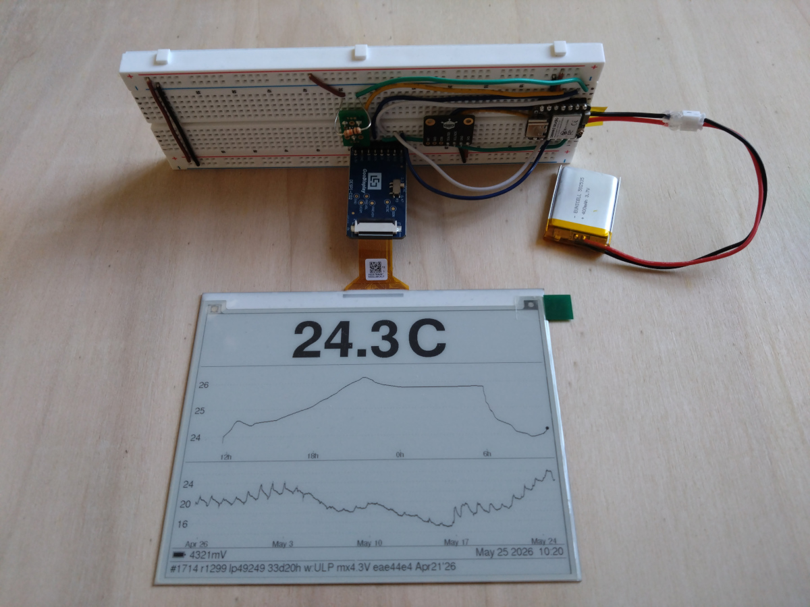
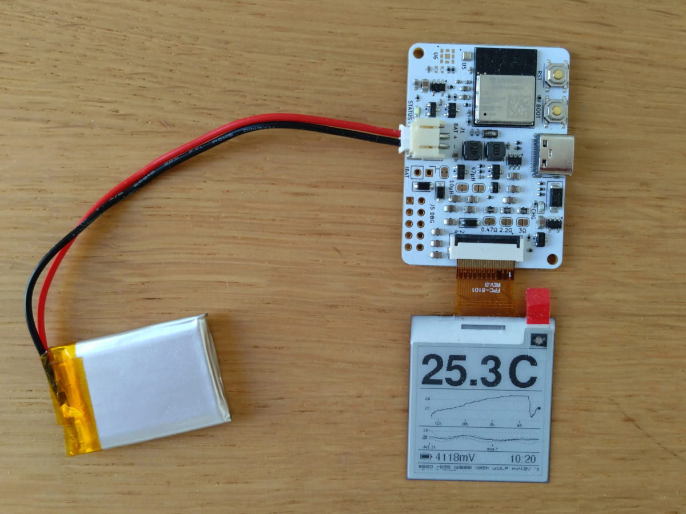
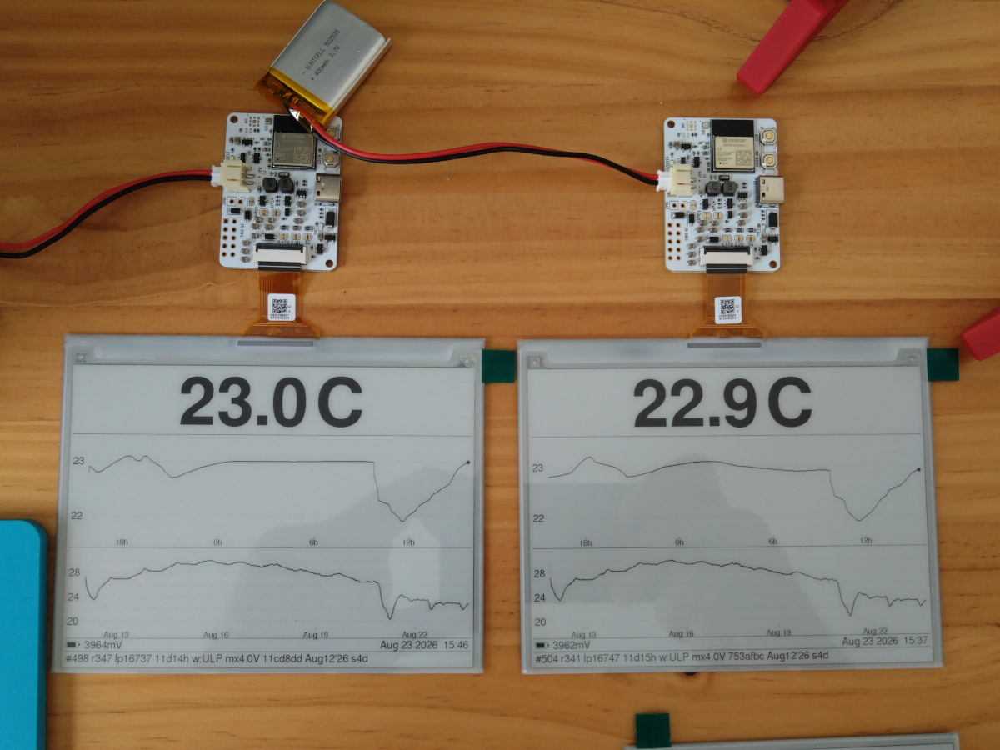
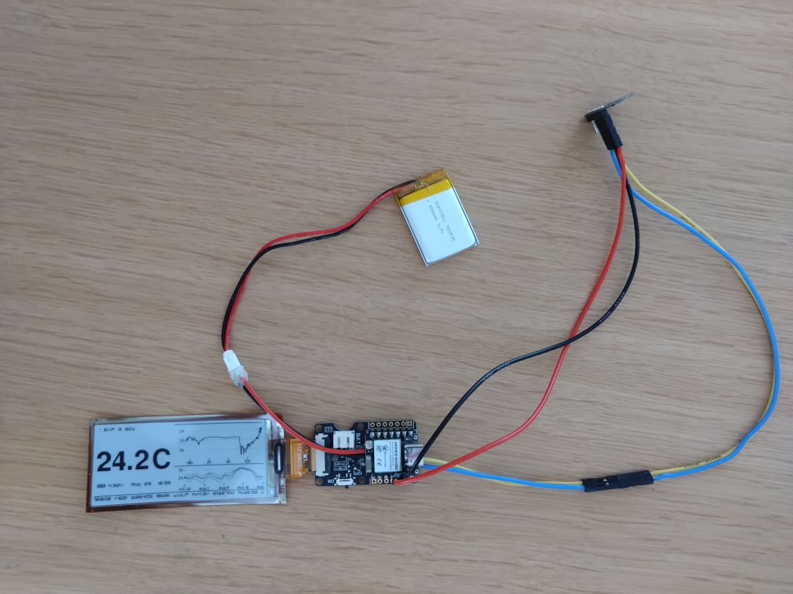
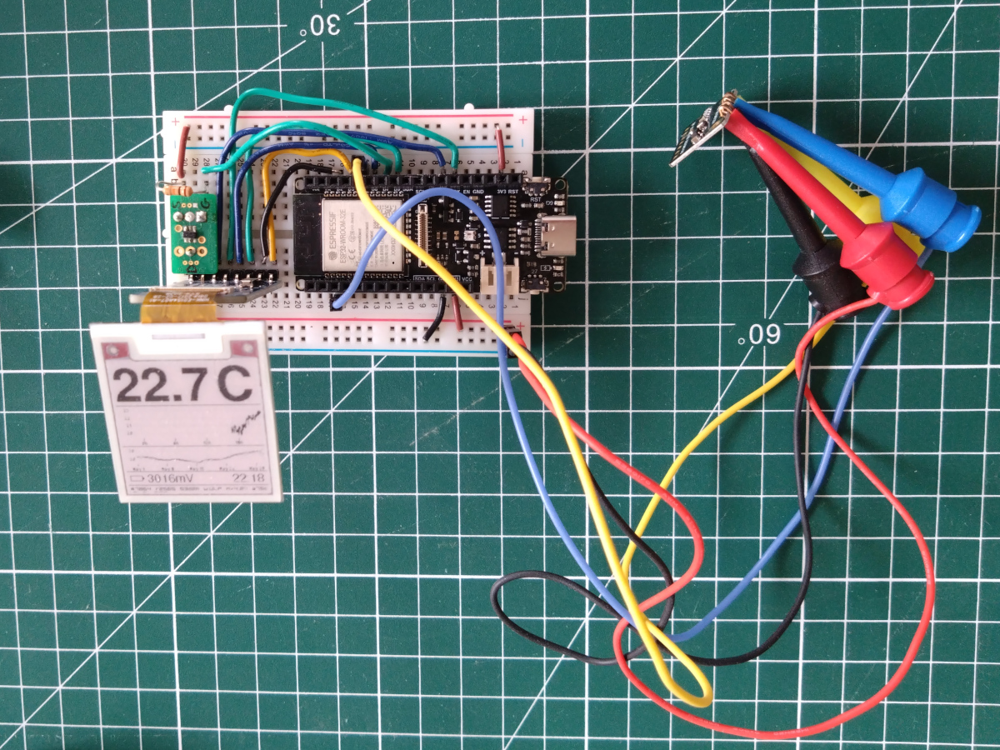
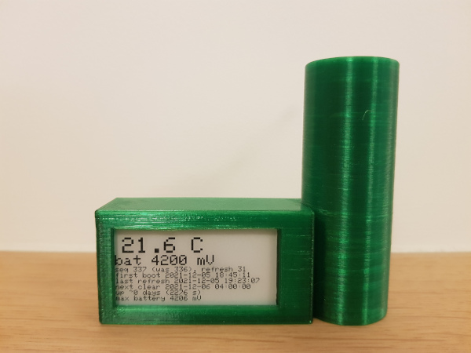

A low power ESP32 based thermometer with an ePaper display

| Prototype | Custom board |
|-----------|--------------|
|||

See [docs/wiring.md](docs/wiring.md) for prototype wiring information and [hardware/thermometer-c6/](hardware/thermometer-c6/README.md) for the custom board. More pictures [lower down](#prototypes-in-action). All logbooks and design docs: [docs/README.md](docs/README.md).

# Power consumption

Measured with a Nordic PPK2 on pure ESP-IDF firmware. Every figure below comes
from a dated entry in [docs/notes.md](docs/notes.md), linked in the Log column.
The July 2026 rows record no supply node and no capture file, so their
`@3V3 rail` tag is this table's assumption (logbook Open items). Figures are
config-specific: panel, sensor and board all matter.

**Read the node tag on every figure.** `@3V3 rail` is the load alone, with the
board's input tree bypassed; `@4V2 bat` is the whole deployment path, regulator
and charger leakage included. A buck reads lower at the battery than at the
rail and an LDO higher, so the tags are not interchangeable.

| Setup | Deep-sleep floor | Sensor wake | Wake + refresh | Log |
|-------|-----------------|-------------|----------------|-----|
| Firebeetle ESP32-E + BMP390L + GDEH0154Z90 via DESPI-C02 (FDN340P gate) | 19–20 µA `@3V3 rail` | ULP bit-bang I2C every 5 s, avg ≈0 | ~112 mC `@3V3 rail` | [-Os, July 2026](docs/notes.md#compile-at--os-july-2026) |
| XIAO ESP32-C6 + BMP581 + GDEH0576T81 via DESPI-C02 (FDN340P gate) | 15.5–16 µA `@3V3 rail` | LP core I2C every 60 s: ~1 mA × 3 ms | ~45 mC `@3V3 rail`, cold-LUT waveform, superseded | [July 2026](docs/notes.md#c6-skip-validate-and--os-combined-july-2026), [LUT, 2026-08-11](docs/notes.md#t81-waveform-lut-selection-under-hardware-spi-rev-a-board-2-2026-08-11) |
| XIAO ESP32-C6 + BMP581 + GDEW029I6FD via Seeed ePaper Driver Board (no gate) | ~25 µA `@3V3 rail` **21.7 µA `@4V2 bat`** | LP core I2C every 60 s: ~1 mA × 3 ms | 12.2 mC `@3V3 rail` **10.05 mC `@4V2 bat`** | [2026-07-26](docs/notes.md#c6-epaper-rig-measured-budget-2026-07-26) |
| thermometer-c6 rev A + BMP581 + GDEM0154I61 (on-board gated booster, LEDs on) | **18.3 µA `@4V2 bat`** | unmeasured | **~24.3 mC `@4V2 bat`** | [2026-07-29](docs/notes.md#budget-as-measured-2026-07-29-thermometer-c6-board-1) |
| thermometer-c6 rev A + BMP581 + GDEH0576T81 (on-board gated booster), the deployment configuration | **19.05 µA `@4V2 bat`** | unmeasured | **36.77 mC `@4V2 bat`** | [2026-08-11](docs/notes.md#budget-as-measured-2026-08-11-thermometer-c6-board-2--t81-the-deployment-config) |

Blank or "unmeasured" cells are unmeasured, not zero. The per-rig summary with
every figure's conditions is the logbook's own [results table](docs/notes.md#results).

The main CPU wakes only on a ≥0.1 °C delta or a safety-net tick, so a display
refresh is the dominant single event on a typical day, while the sleep floor
still dominates the daily budget. Long-term averages land in a ~16–51 µA band
depending on rig and refresh cadence (the low end is a XIAO floor with no
refreshes, the high end the E rig at one refresh per hour), roughly 1–3 years on
a 400 mAh LiPo from the load alone. The deployment configuration comes to
~2.3 C/day at a quiet cadence and ~3.8 volatile, ~380–620 days on 400 mAh at
full capacity, with the cadence rows transferred estimates until the soak
replaces them
([budget entry](docs/notes.md#budget-as-measured-2026-08-11-thermometer-c6-board-2--t81-the-deployment-config)).
LiPo self-discharge (a few %/month, ≈15–25 µA equivalent) rivals that load, so
expect on the order of a year; not yet confirmed by a full-length run.

Two hardware limits that follow from the measurements:
- **XIAO ESP32-C6 on battery has a hard floor at ~3.6 V**: below it the buck rail sags; deep sleep survives, but wakes collapse into brownout-restart storms. Firmware shuts down at 3.7 V; LiFePO₄ cells are unusable on this board; the custom board uses an LDO and shuts down at 3.5 V. Regime map: [notes.md, 2026-07-05](docs/notes.md#xiao-c6-buck-sag-mechanism-and-shutdown-thresholds-2026-07-05).
- **Don't use the Seeed ePaper Driver Board's JST battery connector**: its ETA9740 charger idles at ~20× the system's sleep floor. Solder the cell to the XIAO's underside BAT pads, JST empty, switch off. Measurements: [notes.md, 2026-07-05](docs/notes.md#seeed-xiao-epaper-driver-board-battery-path-via-the-shield-jst-2026-07-05).

For context, the 2021 prototype (wake + refresh every 60 s, no ULP) ran a
2600 mAh cell flat in 8.5 days at ~12.6 mA average; the ULP/LP-core redesign is
~700× more efficient. The Arduino-era ~20 mA deep-sleep USB CDC gotcha is gone:
the pure-IDF USB-Serial-JTAG console does not hold the port active.

# Hardware

Looking to replicate this? Easy to start with options are tagged **[start with this]** below.

## Controller boards
- thermometer-c6 — the custom board this project builds towards, replacing the
  dev-board rigs below: ESP32-C6-MINI-1 + BMP581, a universal 24-pin FPC panel
  interface with the Good Display booster on-board and P-FET-gated, USB-C charging,
  an LDO 3.3 V rail, a GPIO-switched battery divider and a 32.768 kHz crystal.
  Schematic, PCB and rationale: [hardware/thermometer-c6/](hardware/thermometer-c6/README.md)
- Seeed Studio XIAO ESP32-C6 https://wiki.seeedstudio.com/xiao_esp32c6_getting_started/ **[start with this]**
- (Early 2021 prototype) Firebeetle ESP32-E https://wiki.dfrobot.com/FireBeetle_Board_ESP32_E_SKU_DFR0654
  - ESP32 datasheet https://www.espressif.com/sites/default/files/documentation/esp32_datasheet_en.pdf
  - ESP32-WROOM-32E datasheet  https://www.espressif.com/sites/default/files/documentation/esp32-wroom-32e_esp32-wroom-32ue_datasheet_en.pdf
  - TP4056 battery charger IC (onboard) https://dlnmh9ip6v2uc.cloudfront.net/datasheets/Prototyping/TP4056.pdf https://www.best-microcontroller-projects.com/tp4056.html

- ESP32 getting started https://docs.espressif.com/projects/esp-idf/en/latest/esp32/get-started/index.html
- ESP32 power consumption https://diyi0t.com/reduce-the-esp32-power-consumption/

## Temperature sensor (multiple options)
- BMP390L I2C interface:
  - datasheet https://www.bosch-sensortec.com/media/boschsensortec/downloads/datasheets/bst-bmp390-ds002.pdf
  - breakout board https://wiki.dfrobot.com/Fermion_BMP390L_Digital_Barometric_Pressure_Sensor_SKU_SEN0423
- BMP581 / BMP585 I2C interface (Bosch next-gen pressure sensors, ~0.5 µA deep-standby)
  - BMP581 https://www.bosch-sensortec.com/products/pressure-sensors/bmp581/
  - BMP585 https://www.bosch-sensortec.com/products/pressure-sensors/bmp585/
  - Fermion breakouts:
    - SEN0667 (BMP581) https://wiki.dfrobot.com/sen0667/ **[start with this]**
    - SEN0666 (BMP585) https://wiki.dfrobot.com/sen0666/
- (Early 2021 prototype) DS18B20-PAR OneWire interface
  - datasheet https://datasheets.maximintegrated.com/en/ds/DS18B20-PAR.pdf

## Display (multiple options)
- Good Display GDEW0154M09 black and white, 200x200, 1.54" fast full refresh https://www.good-display.com/product/206.html
- Good Display GDEW0213M21 black and white, 212x104, 2.13" DES screen https://www.good-display.com/product/354.html
- Good Display GDEW029I6FD black and white flex, 296x128, 2.9" (UC8151D, partial updates) https://www.good-display.com/product/209.html
- Good Display GDEM0154I61 black and white flex, 200x200, 1.54" (driven via GDEY0154D67 SSD1681 driver) https://www.good-display.com/product/535.html
- Good Display GDEH0576T81 black and white, 920x680, 5.76" HD (SSD2677, partial updates) https://www.good-display.com/product/702.html **[start with this]**
- (Early 2021 prototype) Adafruit 1.54" Tri-Color eInk / ePaper 200x200 Display
  with SRAM - SSD1681 Driver
https://www.adafruit.com/product/4868
https://learn.adafruit.com/adafruit-1-54-eink-display-breakouts?view=all
  - uses Good Display GDEH0154Z90 https://www.good-display.com/product/285.html

Good Display panels are driven through one of two adapters (same Good Display reference booster on both — panel compatibility notes in [docs/wiring.md](docs/wiring.md)):
- Good Display DESPI-C02 (switchable RESE 0.47/3 Ω) https://www.good-display.com/product/516.html
- Seeed ePaper Driver Board for XIAO (fixed RESE 0.47 Ω, ETA9740 charger — see gotcha above) https://www.seeedstudio.com/ePaper-breakout-Board-for-XIAO-V2-p-6374.html — wiki: https://wiki.seeedstudio.com/xiao_eink_expansion_board_v2/ **[start with this]**

The DESPI-C02's boost converter leaks ~534 µA in deep sleep, which an FDN340P
P-channel MOSFET on the adapter's 3.3 V line eliminates; the Seeed board's
ungated standby measured only ~9 µA, so it runs without a gate.

## Other components
- FDN340P P-channel MOSFET (SOT-23) — power-gates DESPI-C02 3.3 V during deep sleep
- AO3400A N-channel MOSFET (SOT-23) — switches the XIAO C6 battery voltage
  divider so it doesn't draw ~10 µA continuously

## Battery
- Current builds: PR502535 single-cell LiPo pouch, 400 mAh https://www.gotronic.fr/art-accu-lipo-3-7-vcc-400-mah-pr502535-5812.htm **[start with this or equivalent]**
- Original prototype: RS Pro 18650 26H Li-ion, 2600 mAh https://fr.rs-online.com/web/p/batteries-taille-speciale/1449406/

## Prototypes in action

### 2026 - ultra low power custom board

Custom rev A board (with BMP581), GDEM0154I61 & 400mAh battery

Custom rev A boards (with BMP581), GDEH0576T81 & 400mAh battery

### 2026 - ultra low power prototypes

Seed Xiao C6, BMP581, GDEH0576T81 & 400mAh battery

Seeed Xiao C6, e-Paper Driver Board, BMP581, GDEW029I6FD & 400mAh battery

Firebeetle ESP32-E, BMP390L, GDEH0154Z90 & 400mAh battery

### 2021 - first prototype
Firebeetle ESP32-E, DS18B20, GDEW0213M21 & 2600mAh battery

